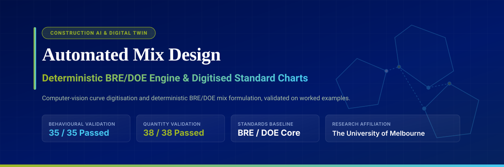
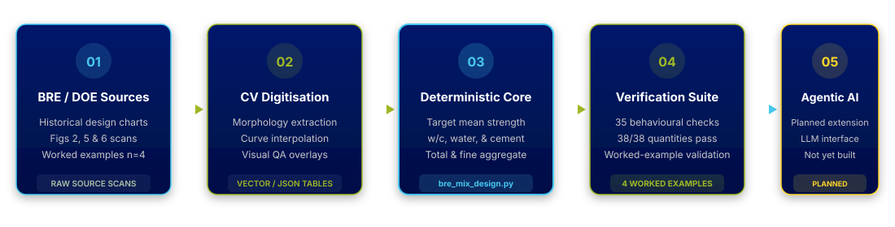

<p align="center">
  
</p>

<p align="center">
  <a href="#overview"></a>
  <a href="#current-status--benchmark-evidence"></a>
  <a href="#current-status--benchmark-evidence"></a>
  <a href="#3-run-reproducibility-verification"></a>
  <a href="#licence-and-permitted-use"></a>
  <a href="https://www.unimelb.edu.au/"></a>
</p>

---

## Overview

Concrete mix design is the rigorous process of determining the proportions of cement, water, fine aggregate, and coarse aggregate required to achieve a specified **characteristic compressive strength**, target **workability (slump)**, and **durability** requirements.

This repository implements an automated framework for the British **BRE/DOE (Building Research Establishment / Department of the Environment)** concrete mix-design procedure (2nd edition, 1997; BS 5328 / EN 206). It replaces manual reading of the printed nomograms with **computer-vision digitised curve models** and a **deterministic calculation engine**, which is validated against four worked examples (see [Current Status](#current-status--benchmark-evidence)). An agentic decision-support layer is a planned extension and is not part of this release.

<p align="center">
  
</p>

<p align="center"><sub>Stage 05 (agentic layer) is a planned extension. Stages 01 to 04 are implemented in this repository.</sub></p>

---

## Computer-Vision Chart Digitisation & QA

The BRE/DOE method relies on three graphical nomograms that are vulnerable to manual reading variation. In this framework the charts are digitised from high-resolution scans, with programmatic quality-assurance overlays:

* **Strength versus free water/cement ratio:** about 19,000 extracted points pooled into a fixed-effects ordinary least squares model, giving a chart-derived Abrams exponent ln(B) = 2.9996.
* **Estimated wet density:** digitised density planes parameterised across aggregate saturated-surface-dry (SSD) relative densities of 2.4 to 2.9.
* **Fine aggregate proportion:** multi-panel interpolation across slump bands (0 to 10 mm up to 60 to 180 mm) and maximum aggregate sizes.

The digitised curve data are in [`Code/bre_engine/data/`](Code/bre_engine/data). The chart scans and the QA overlay images, which reproduce the printed BRE charts, are not redistributed in this repository.

---

## Current Status & Benchmark Evidence

* **Deterministic core:** `Code/bre_engine/bre_mix_design.py` passes all **35 behavioural checks** (`Code/bre_engine/test_bre_engine.py`).
* **Worked-example validation:** all **38 of 38** target quantities from four worked examples fall within tolerance (`Code/bre_engine/validate_examples.py`, results in [`validation_results.csv`](Code/bre_engine/validation_results.csv)). Acceptance: each mass within 3% of the reference value or 15 kg/m³ (whichever is larger), and free water/cement ratio within 0.005.
  * **Tier 1** (the worked example's own chart readings are injected, which isolates the calculation logic): largest deviation 0.5% of the reference value.
  * **Tier 2** (fully automated, every chart value read from the digitised curves): largest deviation 2.5% of the reference value (Example 1, fine aggregate); largest absolute deviation 14.0 kg/m³ (Example 1, coarse aggregate).
* **Release status:** the engine is a release candidate (`v1.0-rc1`). Validation is a bounded implementation-fidelity check on n = 4 worked examples, with broader boundary-condition testing planned.
* **Scope:** the BRE core method only. Admixtures, air entrainment and supplementary cementitious materials are not covered.
* **Chart-reading uncertainty:** digitisation inherits the resolution of the printed 1997 charts, about ±0.02 in free water/cement ratio for the strength chart and about 1 to 2 percentage points for the other two charts.

---

## Repository Structure

```text
├── assets/                          # Banner and pipeline diagram
├── Code/
│   ├── bre_engine/
│   │   ├── bre_mix_design.py        # Calculation engine (BREInput -> design_mix -> BREResult)
│   │   ├── digitize_fig2.py         # Curve extraction, strength vs w/c chart (needs chart scans, not included)
│   │   ├── digitize_fig3.py         # Curve extraction, wet density chart (needs chart scans, not included)
│   │   ├── digitize_fig4_v2.py      # Curve extraction, fine aggregate chart (needs chart scans, not included)
│   │   ├── test_bre_engine.py       # Behavioural and unit tests (35 checks)
│   │   ├── validate_examples.py     # Worked-example validation runner (38 quantities, 2 tiers)
│   │   ├── validation_results.csv   # Latest validation output
│   │   └── data/                    # Digitised JSON curve and coefficient tables
│   └── run_reproducibility.py       # One-command reproducibility runner
├── requirements.txt
└── README.md
```

---

## Quick Start & Usage

> **Note:** the code may be used only with the copyright holders' prior written permission (see [Licence and Permitted Use](#licence-and-permitted-use)). The steps below document how the reported results are reproduced.

### 1. Installation

```bash
# Clone the repository
git clone https://github.com/morehosseini/automated-mix-design.git
cd automated-mix-design

# Install dependencies
pip install -r requirements.txt
```

### 2. Programmatic Mix Design

```python
from Code.bre_engine.bre_mix_design import BREInput, design_mix

# Configure mix specifications
mix_input = BREInput(
    fck=30.0,                     # Characteristic compressive strength (N/mm²)
    defectives_pct=5.0,           # Proportion defective (%); k = 1.64 for 5%
    sd=8.0,                       # Standard deviation (N/mm²)
    cement_class=42.5,            # Ordinary Portland Cement
    coarse_type="crushed",        # Crushed coarse aggregate
    fine_type="uncrushed",        # Uncrushed natural sand
    slump_mm=(30, 60),            # Target slump range (mm)
    max_agg_mm=20,                # Maximum aggregate size (mm)
    fines_passing_600um_pct=60.0, # Grading: % passing 600 µm sieve
    agg_sg_ssd=2.65               # Saturated surface-dry relative density
)

# Execute deterministic calculation
result = design_mix(mix_input)

# Formulated quantities (kg/m³)
print(f"Target Mean Strength : {result.target_mean:.1f} N/mm²")
print(f"Free-Water / Cement  : {result.wc_used:.2f}")
print(f"Free Water           : {result.water:.0f} kg/m³")
print(f"Cement Content       : {result.cement:.0f} kg/m³")
print(f"Fine Aggregate (SSD) : {result.fine_ssd:.0f} kg/m³")
print(f"Coarse Aggregate     : {result.coarse_ssd:.0f} kg/m³")
```

### 3. Run Reproducibility Verification

To run the unit checks and the worked-example validation using the checked-in digitised data:

```bash
python3 Code/run_reproducibility.py --skip-digitization --skip-notebook
```

Re-running the digitisation scripts (`Code/bre_engine/digitize_fig*.py`) requires scans of the BRE charts, which are not redistributed here.

---

## Source and Attribution

This is an independent implementation of the procedure published in *Design of Normal Concrete Mixes* (BRE, 2nd edition, 1997). The transcribed tables and the digitised chart data derive from that publication, which remains the property of its owners. This repository is not affiliated with or endorsed by BRE. Provenance notes in the code docstrings refer to source files and project records that are held in the authors' working repository and are not part of this release.

---

## Licence and Permitted Use

Copyright (c) 2026 M. Reza Hosseini and Amila Premakumara, The University of Melbourne. All rights reserved.

This repository is publicly visible for transparency and review only. No permission is granted to use, copy, modify, distribute or build on the code, data or documentation without prior written permission. See [`LICENSE`](LICENSE) for the full notice, and contact [mreza.hosseini@unimelb.edu.au](mailto:mreza.hosseini@unimelb.edu.au) to request permission.

---

## Research Team & Contributors

| **Dr M. Reza Hosseini** | **Amila Premakumara** |
| :--- | :--- |
| **Senior Lecturer in Construction Technology**<br>Faculty of Architecture, Building and Planning<br>The University of Melbourne<br>📧 [mreza.hosseini@unimelb.edu.au](mailto:mreza.hosseini@unimelb.edu.au)<br>🎓 [Find an Expert Profile](https://findanexpert.unimelb.edu.au/profile/862492-m.-reza-hosseini)<br>💼 [LinkedIn Profile](https://www.linkedin.com/in/reza-hosseini-unimelb/) | **Graduate Researcher in Civil Engineering**<br>Department of Infrastructure Engineering<br>Faculty of Engineering and Information Technology<br>The University of Melbourne<br>🎓 [University Profile](https://infrastructure.eng.unimelb.edu.au/people/graduate-researchers/civil-engineering/amila-premakumara)<br>💼 [LinkedIn Profile](https://www.linkedin.com/in/amila-premakumara/) |

---

## Citation

If you refer to this engine or digitisation pipeline in your work, please cite:

```bibtex
@misc{hosseini2026automatedmix,
  author       = {Hosseini, M. Reza and Premakumara, Amila},
  title        = {Automated Concrete Mix Design: Deterministic Standards Digitisation (software repository)},
  institution  = {The University of Melbourne},
  year         = {2026},
  howpublished = {\url{https://github.com/morehosseini/automated-mix-design}}
}
```

---
<p align="center">
  <sub>The University of Melbourne &bull; Faculty of Architecture, Building and Planning &bull; Faculty of Engineering and Information Technology &bull; CRICOS Provider Code: 00116K</sub>
</p>
